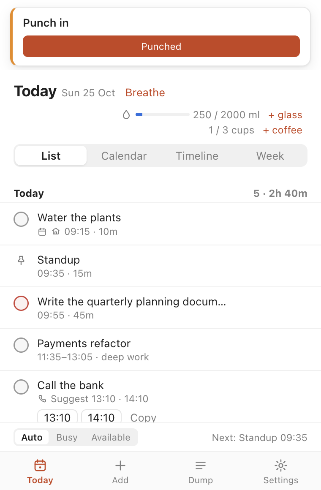
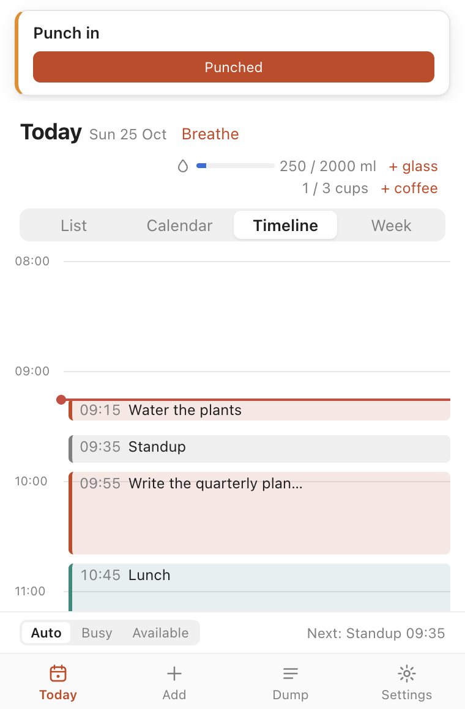
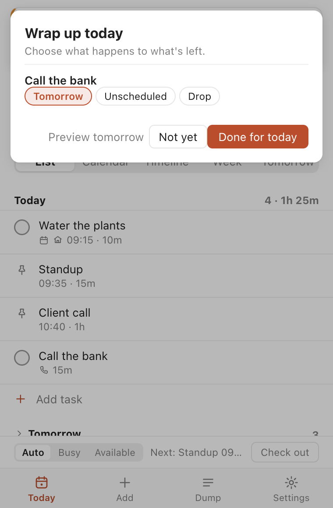
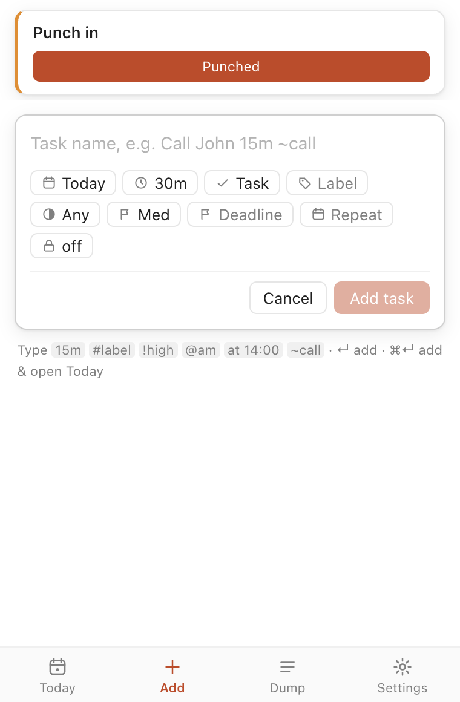
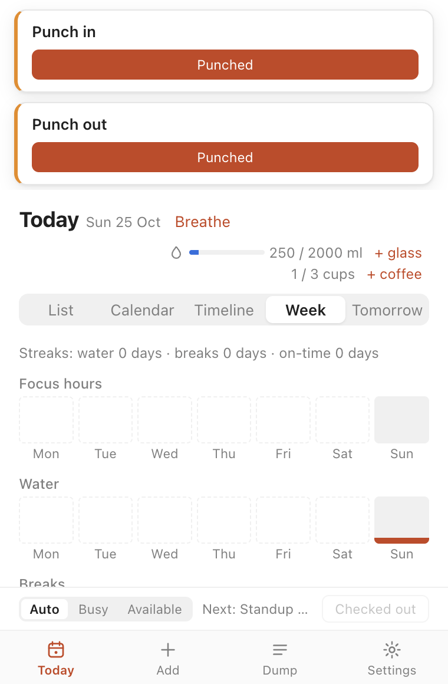

# Dayfit

Dayfit is a menu bar (macOS) and system tray (Windows) day planner for people who work long hours at a computer. You type or paste the day's tasks, calls and fixed items, and Dayfit schedules them around the things that cannot move. Health reminders sit on top of the plan, so breaks land in real gaps and never interrupt a meeting. Everything runs offline and all data stays on your machine.

<p align="center">
  
  
  
</p>

## What it does

- **Planning.** Quick-add one line at a time (`Call John 15m ~call @am`) or brain-dump the morning's list and press "Plan my day". The scheduler fits tasks around meetings and other fixed items, inside working hours, with short buffers, similar tasks batched and a lunch block. It explains overflow and asks before moving anything to tomorrow. Drag a task on the timeline to lock it at a time. Calls get suggested slots ("Call John: 11:30 or 14:15").
- **Breaks.** Eye rest (20-20-20), water toward a daily target, stretching and walking, combined into one reminder and placed in real gaps, never in a meeting. Snooze, Busy mode and per-task do-not-disturb keep them out of deep work. A focus timer (25 or 50 min) holds breaks and offers a short one after.
- **End of day.** Check-in and check-out reminders (with an optional link to your HR portal), a wrap-up screen that sends what's left to tomorrow, to unscheduled or drops it, a preview of tomorrow, a daily summary, an overtime nudge and an evening wind-down.
- **Wellbeing nudges.** Posture and desk set-up, daylight, mood check-ins, call fatigue after long meeting runs, guided box breathing, caffeine cap and cut-off, sit/stand, meal and medication reminders. Mouse pace feeds a tiredness signal; optional on-device camera cues (below) add blinks, yawns and posture.
- **Week view.** The last seven days of focus time, water and breaks, plus streaks.
- **Backup.** Export everything to one JSON file from Settings and import it on another machine.
- **Optional Google Calendar sync** for meetings in and planned blocks out (below).

It lives in the macOS menu bar or the Windows tray, opens with a global shortcut, and works with the keyboard.

<p align="center">
  
  
</p>

## Install

Build it yourself (see [Build](#build)), or download a release once they are published: a `.dmg` for macOS (Apple silicon `arm64` or Intel `x64`) or a `-setup.exe` for Windows.

Release builds are not signed with a trusted certificate yet:

- **macOS:** builds are ad-hoc signed, so Gatekeeper blocks the first launch ("Apple could not verify…"). Try to open Dayfit once, then open **System Settings → Privacy & Security** and click **Open Anyway** next to the Dayfit message. Only do this for a build you downloaded from this project or built yourself. An ad-hoc signature changes with every build, so macOS asks for camera access again after each update.
- **Windows:** SmartScreen warns about an unknown publisher. Click **More info → Run anyway**.

### Known limitation: notifications on unsigned macOS builds

macOS may not show notifications from an unsigned app, so Dayfit's reminders can stay silent. Nothing is lost: each reminder also appears as a label next to the menu-bar icon and as a banner in the popover, where you can act on it. This goes away once builds are signed (on the roadmap). It also affects `npm run dev`.

## Syntax cheat-sheet

Syntax is optional: every field can also be set by clicking. Tokens are case-insensitive and can appear anywhere in the line. Whatever is left over becomes the title.

| Token                            | Meaning                                                                 | Example                           |
| -------------------------------- | ----------------------------------------------------------------------- | --------------------------------- |
| `30m`, `2h`, `1h30m`             | Duration                                                                | `Review PRs 45m`                  |
| `#label`                         | Label                                                                   | `#work`                           |
| `!high` `!med` `!low`            | Priority                                                                | `!high`                           |
| `@am` `@pm`                      | Prefer morning or afternoon                                             | `@pm`                             |
| `today`                          | Plan for today                                                          | `today`                           |
| `tomorrow`                       | Plan for tomorrow                                                       | `tomorrow`                        |
| `mon`..`sun`, `monday`..`sunday` | Next such weekday (today counts)                                        | `fri`                             |
| `at <time>`                      | Fixed start time (makes the item fixed; household items stay household) | `at 14:30`, `at 2pm`, `at 9:15am` |
| `by tomorrow`, `by <weekday>`    | Deadline on that day                                                    | `by friday`                       |
| `by <time>`                      | Deadline today at a time (there is no `by today`)                       | `by 5pm`                          |
| `~call`                          | Item type: call                                                         | `~call`                           |
| `~deep`                          | Item type: deep work                                                    | `~deep`                           |
| `~home`                          | Item type: household                                                    | `~home`                           |

Times accept `14:30`, `2pm` and `2:30pm`. Example: `Call John 15m #work !high @am today ~call`.

## Privacy

Everything stays on your machine. There is no account, no cloud, no telemetry, no analytics and no update check. Dayfit makes no network requests at all unless you connect Google Calendar (below), and then it talks only to Google. Camera cues (below) run entirely on your Mac: no frame is stored or sent.

Data lives in one SQLite database:

- macOS: `~/Library/Application Support/Dayfit/dayfit.db`
- Windows: `%APPDATA%\Dayfit\dayfit.db`

Delete that folder to remove all of Dayfit's data. Backups are plain JSON files that you save where you choose.

## Google Calendar (optional)

Dayfit can bring today's meetings in as fixed items and, if you turn it on, show your planned task and deep-work blocks on your calendar as busy time. You use your own Google OAuth client:

1. In [Google Cloud Console](https://console.cloud.google.com/), pick or create a project.
2. Enable the **Google Calendar API**.
3. Create an **OAuth client ID** of type **Desktop app** (set up the consent screen first if asked; add yourself as a test user).
4. In Dayfit, open **Settings → Google Calendar**, paste the client ID and client secret, and click **Connect**.

Sign-in happens in your browser. Dayfit first asks for read-only access; it asks again for write access only when you turn on "Show my planned blocks on Google Calendar". The sign-in token is encrypted with the system keychain and kept out of backups. Dayfit only edits or deletes events it created itself. Sync runs every 15 minutes, when the Mac wakes, and on **Sync now**.

## Camera cues (optional, off by default)

Turn on **Settings → Camera cues** and Dayfit watches for signs that you need a break: few blinks (dry eyes), drooping eyes or yawning (tiredness), slouching, and sitting too close to the screen. Each becomes a gentle nudge, at most one every 30 minutes per cue.

- Face landmarks are found on-device with Google's MediaPipe; the model ships inside the app and nothing is downloaded at run time.
- Frames never leave the hidden camera page. Dayfit keeps only per-minute numbers (blinks, eyes-closed share, yawns, head position) for today, plus a daily total in the summary.
- The camera runs only on work days, in work hours, when you aren't in a meeting, busy, away (5 min idle) or locked, and stops when you check out. The green light tells you when it's on.
- Posture and distance compare against a one-time **Calibrate** ("sit the way you want to sit"). If your setup looks very different on a given day, those two cues pause and Settings asks you to recalibrate.
- In development (`npm run dev`) macOS asks for camera access on behalf of Electron, not Dayfit.

## Develop

Requires Node.js 24 or later and npm.

```sh
npm install        # also downloads Electron
npm run dev        # run with hot reload
npm test           # Vitest
npm run lint
npm run typecheck  # both TypeScript projects
```

To capture screenshots of every screen, build and run the driver (it uses a throwaway profile):

```sh
npx electron-vite build
node scripts/drive.mjs docs/screenshots/raw
```

See [CONTRIBUTING.md](CONTRIBUTING.md) for the test-first workflow and project layout.

## Build

```sh
npm run build      # typecheck, then build into out/
npm run dist:mac   # dist/Dayfit-<version>-{arm64,x64}.dmg and -mac.zip
npm run dist:win   # dist/Dayfit-<version>-setup.exe
```

Run each on its own platform. The first build downloads the Electron binaries for the target. The app icon comes from `build/icon.svg`; after editing it, run `npm run icons` (on macOS, for the `.icns`) to regenerate `build/icon.png`, `build/icon.icns` and `build/icon.ico`.

### Signing

macOS builds are ad-hoc signed by default (`mac.identity: '-'`, `notarize: false` in `electron-builder.yml`) and Windows builds are unsigned, so macOS Gatekeeper and Windows SmartScreen will warn on first launch. To sign:

- macOS: install a Developer ID Application certificate in your keychain, remove `identity: '-'` and `hardenedRuntime: false`, set `notarize: true`, and export `APPLE_ID`, `APPLE_APP_SPECIFIC_PASSWORD` and `APPLE_TEAM_ID`.
- Windows: set `CSC_LINK` and `CSC_KEY_PASSWORD` to your code-signing certificate before running `dist:win`.

## Roadmap

See [TODO.md](TODO.md) for v1 scope, later versions and the full backlog.

## License

[MIT](LICENSE)
